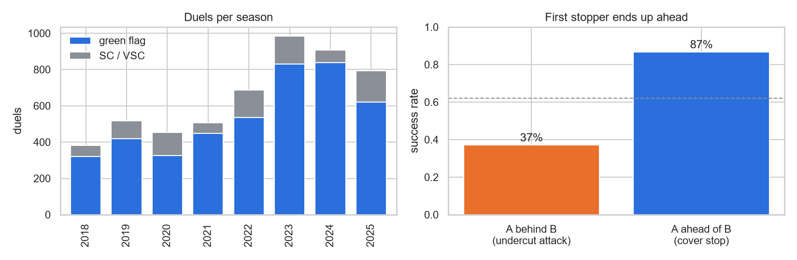
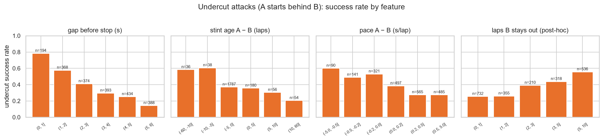

# Predicția reușitei undercut-ului vs. overcut-ului în Formula 1

Proiect IAPD (Învățare automată și procesarea datelor), UPB. Proiect nr. 21, autor: Mihai Andrei-Dragoș.

Construim un dataset propriu de **„dueluri de strategie”** din cursele de Formula 1 din sezoanele 2018–2025. Un duel e o pereche de piloți aflați la cel mult 6 s unul de altul, în care unul oprește la boxe înaintea celuilalt. Prezicem dacă pilotul care oprește primul iese în față după ce ambii au oprit (**undercut reușit**) sau dacă cel rămas pe pistă își păstrează sau câștigă avantajul (**overcut**).

## Rezultate Phase 1

- **5.231 de dueluri** din 171 de curse (2018–2025), 31 de circuite și 43 de piloți; 4.342 sunt pe steag verde
- **36 de features**: 26 pre-decizie (toți anii), 6 de anvelope (2023+), 4 post-hoc (doar pentru analiză)
- Dataset: [`data/processed/duels.csv`](data/processed/duels.csv); statistici pe cursă: [`data/processed/races.csv`](data/processed/races.csv)

**Observații din EDA:**
- Contează enorm cine era în față la oprire. Când A **atacă din spate** (2.151 de dueluri), undercut-ul reușește în **37%** din cazuri. Când A e **deja în față**, își păstrează locul în **87%** din cazuri.
- La atacuri, rata de succes scade puternic cu gap-ul: **78%** sub 1 s, **14%** la 5–6 s. Crește când A e mai rapid în turele dinaintea opririi.




**Baseline-uri** (antrenare 2018–2023, test temporal 2024–2025, ROC-AUC; pentru validare: GroupKFold pe cursă, vezi [`reports/phase1/baselines.csv`](reports/phase1/baselines.csv)):

| Model | Toate duelurile | Doar atacuri |
|---|---|---|
| Dummy (clasa majoritară) | 0,50 | 0,50 |
| Regula „ordinea se păstrează” | 0,77 | 0,50 |
| Gaussian Naïve Bayes | 0,78 | 0,72 |
| Decision Tree (adâncime 4) | **0,82** | 0,70 |
| kNN (k = 25) | **0,82** | **0,74** |

Pe toate duelurile, regula simplă „cine e în față rămâne în față” e un baseline puternic. Pe atacuri, regula nu mai ajută, dar modelele găsesc semnal real. Phase 2 se concentrează pe atacuri.

**Validarea detecției SC/VSC** față de mesajele oficiale de race control din OpenF1, pe 4.094 de tururi din 2023–2025: precizie 0,78, recall 0,87, acuratețe 0,98 ([`reports/phase1/sc_detector_validation.csv`](reports/phase1/sc_detector_validation.csv)).

Alte figuri (rata de succes pe circuite, valori lipsă, corelații, outlieri la timpii în pit lane) sunt în [`reports/phase1/figures/`](reports/phase1/figures/), iar statisticile descriptive în [`reports/phase1/descriptive_stats.csv`](reports/phase1/descriptive_stats.csv).

## Surse de date

| Sursă | Ce folosim |
|---|---|
| [Jolpica-F1 API](https://github.com/jolpica/jolpica-f1) (succesorul Ergast) | calendar, circuite (coordonate), rezultate, **timpi pe tur și poziții pentru fiecare pilot**, opriri la boxe (tur, timp în pit lane) |
| [OpenF1 API](https://openf1.org) | compusul anvelopelor și vârsta reală a anvelopelor (stints), mesaje race control (SC/VSC); disponibil din 2023 |
| [Open-Meteo Historical Weather API](https://open-meteo.com/en/docs/historical-weather-api) | vremea orară la circuit: temperatură, umiditate, precipitații (în cursă și în cele 3 ore dinainte), nori, vânt |
| [Wikipedia: List of Formula One circuits](https://en.wikipedia.org/wiki/List_of_Formula_One_circuits) | lungimea circuitului, numărul de viraje, tipul (stradal/permanent), sensul |

> **Notă despre FastF1:** planul inițial folosea FastF1 (F1 live timing). Din 2026, arhiva `livetiming.formula1.com` cere un cont cu abonament F1TV (răspunde cu HTTP 401 fără autentificare). De aceea, timpii pe tur vin din Jolpica, compușii din OpenF1, iar perioadele de SC/VSC sunt deduse din timpii pe tur (vezi mai jos).

## Definiția unui duel

Pentru fiecare oprire a unui pilot **A** în turul `L_A`:

- **B** era la cel mult `6 s` de A (în față sau în spate) la finalul turului `L_A − 1`;
- B nu oprește în același tur, nu a oprit în ultimele 5 tururi și oprește în turul `L_B`, cu `L_A < L_B ≤ L_A + 10`;
- A nu mai oprește o dată până la `L_B + 1`, iar ambii termină turul `L_B + 1`.

**Țintă:** `undercut_success = 1` dacă A e înaintea lui B la finalul turului `L_B + 1`, după timpul cumulat de cursă.

**SC/VSC:** un tur e considerat neutralizat dacă mediana timpilor pe tur din pluton depășește de 1,15 ori ritmul pe steag verde al cursei. Duelurile cu neutralizare între `L_A` și `L_B + 1` primesc `neutralized = 1` și sunt excluse din setul principal. Pentru 2023+, detecția se poate valida cu mesajele race control din OpenF1.

## Features

Toate features-urile sunt definite în [`src/features.py`](src/features.py).

- **Pre-decizie** (cunoscute când A intră la boxe, pentru toți anii):
  - gap-ul dintre A și B, cine era în față, poziția lui A, dacă sunt colegi de echipă, a câta oprire e pentru A;
  - vârsta stintului pentru A și B și diferența dintre ele, diferența de ritm pe ultimele 3 tururi;
  - traficul estimat la ieșirea din boxe și gap-ul față de mașina din față la reintrare;
  - tururile rămase și progresul cursei;
  - pierderea la boxe pe circuit și ușurința depășirilor pe circuit (ambele calculate *leave-one-season-out*);
  - lungimea circuitului, numărul de viraje, circuit stradal;
  - vremea (Open-Meteo) și era regulamentară (2022+).
- **Anvelope (doar 2023+):** compusul vechi și cel nou, vârsta reală a anvelopelor.
- **Post-hoc** (știute doar după fapt, folosite doar pentru analiză și ablație): câte tururi a mai stat B pe pistă, timpii în pit lane, compusul nou al lui B.

## Rulare

```bash
pip install -r requirements.txt
python -m src.fetch_raw              # descarcă datele brute (lent: ~5 h din cauza limitei Jolpica; reluabil, cu cache)
python -m src.build_dataset          # -> data/processed/duels.csv, races.csv
python -m src.eda                    # -> reports/phase1/figures, descriptive_stats.csv
python -m src.baselines              # -> reports/phase1/baselines.csv
python -m src.validate_sc            # -> reports/phase1/sc_detector_validation.csv
```

`python -m src.build_dataset --offline` construiește datasetul doar din cursele deja descărcate.

## Structura repository-ului

```
config.yaml              parametri (praguri duel, sezoane)
src/sources/             clienți pentru Jolpica, OpenF1, Open-Meteo, Wikipedia (cu cache pe disc)
src/duels.py             extragerea duelurilor și etichetarea
src/build_dataset.py     integrarea surselor și features derivate
src/eda.py               analiza exploratorie
src/baselines.py         modelele baseline pentru Phase 1
data/processed/          datasetul final (versionat)
reports/phase1/          figuri, statistici, rezultate baseline
```

## Evaluare

- Setul principal: dueluri pe steag verde.
- Validare încrucișată: **GroupKFold pe cursă** pentru 2018–2023 (duelurile din aceeași cursă nu ajung și în train, și în validare).
- **Test temporal:** 2024–2025.
- Metrici: accuracy, balanced accuracy, F1, ROC-AUC.
- Phase 1 (baseline-uri): Dummy, regula „ordinea se păstrează”, Gaussian Naïve Bayes, Decision Tree, kNN.
- Phase 2: SVM, Random Forest, gradient boosting, MLP, tuning, importanța features-urilor, ablație pre-decizie vs post-hoc.
